## 👋 Opa! Seja bem-vindo

`📌 Estudante de Engenharia de Software | Programador TypeScript Full‑Stack no tempo livre`

Olá, me chamo Yuri! Sou um estudante que adora matemática e tecnologia. Invisto a maior parte do meu tempo livre [estudando](https://yur1-notes.netlify.app) ou desenvolvendo projetos de código aberto

 

  
<b>💻 &nbsp;Conhecimento Técnico</b>

    

  
<b>🧠 &nbsp;Aprendendo...</b>

    

  
<b>📊 &nbsp;Stats</b>

    

<picture>
    <source 
      srcset="./cards/stats_dark.svg"
      media="(prefers-color-scheme: dark)"
      width="50%"
    /> 
    <source 
      srcset="./cards/stats_light.svg"
      media="(prefers-color-scheme: light), (prefers-color-scheme: no-preference)"
    />
    
  </picture>
  <picture>
    <source
      srcset="./cards/top-langs_dark.svg"
      media="(prefers-color-scheme: dark)"
      width="40%"
    />
    <source 
      srcset="./cards/top-langs_light.svg"
      media="(prefers-color-scheme: light), (prefers-color-scheme: no-preference)"
    />
    
  </picture>

